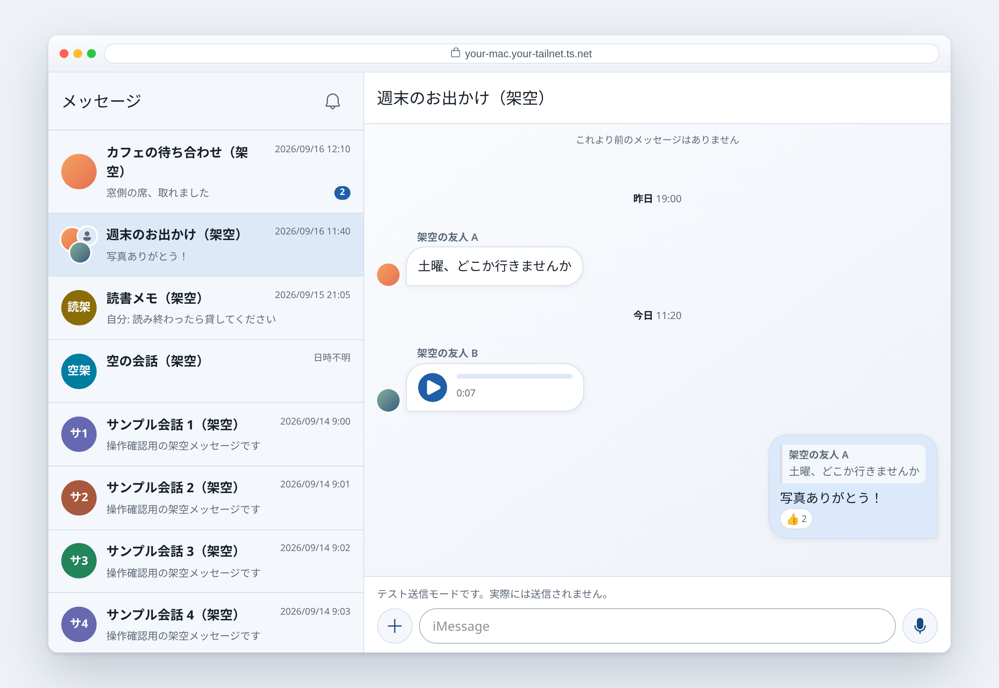
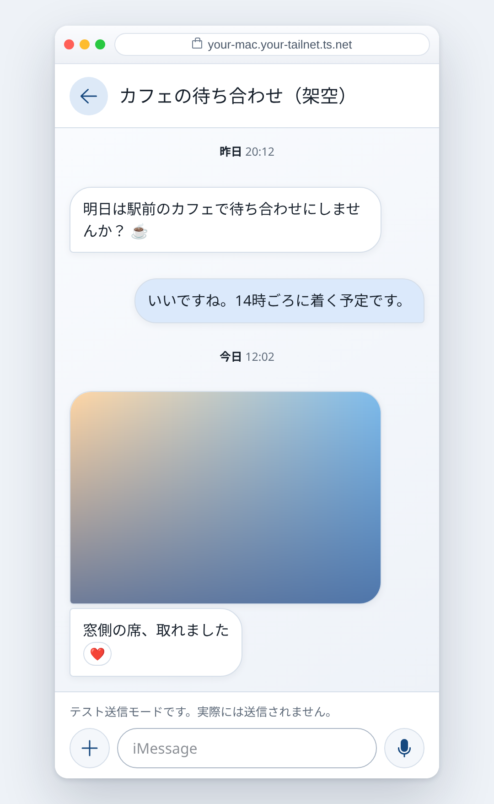

# imsg-web

[English](README.md) · **日本語**

自分の Mac が配信する、iMessage のウェブ画面です。

[`imsg`](https://github.com/openclaw/imsg) CLI の上に載せた小さなウェブ UI です。メッセージは
Mac の中にあり、ローカルのサーバーがそれを読みます。どこかに複製されることも、インターネットに
出ることもありません。サーバーは Mac 本体と家の LAN で待ち受け、インストール時に決まったアドレス
以外には答えません。

**一人が自分の Mac で使う**ためのものです。

<p align="center">
  
  <br><br>
  
</p>

<p align="center"><sub>上の画面に出ているものは<strong>すべて架空</strong>です（<code>scripts/demo-preview.mjs</code> のプレビュー）。
実在の会話に由来するものはありません。</sub></p>

## できること

- **会話リストと履歴**。15秒ごとに更新、最新から開いてスクロールで遡ります
- **画像**。本体が未ダウンロードなら Messages のキャッシュしたサムネイル。クリックで拡大表示、
  ピンチとホイールでズーム
- **音声メッセージ**をその場で再生
- **連絡先の写真**。グループは参加者の顔を1つの円に集めて表示
- **返信とリアクションの表示**。引用を押すと返信元へ移動
- **リンクカード**。Messages が保存済みのプレビューから
- **送信**。テキスト、ファイル、ブラウザーで録音した音声
- **新着通知**（有効にした場合）
- **ほかのプログラムからの API**。自分で発行した連携用トークンで、読み取りと送信（[`docs/api.md`](docs/api.md)）

**できないこと**：返信としての送信、リアクションの送信、既読、入力中の表示、検索。
最初の2つは imsg のブリッジが必要で、SIP の無効化と Messages へのコード注入を要求するため、
このプロジェクトでは扱いません。

## セットアップ

Messages にサインイン済みでスリープしない Mac と、Xcode Command Line Tools
（`xcode-select --install`）が必要です。

```sh
git clone https://github.com/MoomA-0750/imsg-web && cd imsg-web
./scripts/setup.sh
```

Node 24 の取得、アプリとパッチ済み `imsg`（[`imsg-patches/`](imsg-patches/)）のビルドを行い、
サーバーを起動します。最後に、開くアドレスと仮パスワードを表示します。

そのあと一度だけ：

1. **表示された Node バイナリに Full Disk Access を与え**（システム設定 → プライバシーと
   セキュリティ → フルディスクアクセス）、表示されたコマンドでサーバーを再起動します。
   これがないとメッセージを読めません。
2. **表示されたアドレスを開きます**。`https://your-mac.local:8787` か Mac の IP アドレスで、
   Mac 本体でも同じ Wi-Fi の端末でも使えます。端末ごとに一度だけ「安全ではない」警告が出ます
   （Mac の中で作った自己署名の証明書のため）。指紋がインストーラの表示と同じなら先へ進みます。
3. **仮パスワードでログインします**。自分のパスワードを決める画面になり、決めると仮パスワードは
   使えなくなります。

更新は `git pull && ./scripts/setup.sh`。直前の版は戻り先として残ります。

オプションはそのままインストーラに渡ります。`--no-lan` で Mac 本体だけ
（`https://localhost:8787`）、`--send off` で送信を無効にします。

### 外出先から開くには

[Tailscale](https://tailscale.com) を使います。両方の端末で動いていれば、Mac の Tailscale の
IP アドレスでそのまま開けます。正式な証明書の付いた名前で開くなら、Serve に載せてそのアドレスで
入れ直します：

```sh
tailscale serve --bg https+insecure://127.0.0.1:8787
./scripts/setup.sh --origin https://your-mac.your-tailnet.ts.net
```

## 使い方

- **送信**は丸いボタン、または Ctrl+Enter / ⌘+Enter。確認のステップはありません
- **録音**はマイクのボタン（送るものが無いとき、送信ボタンの位置がマイクになります）。
  録音したものは他の添付と同じ列に並び、送信は別の操作です
- **添付**は `＋`。複数のファイルは複数のメッセージとして送られます
- **画像**はクリックで拡大表示。ホイール・ピンチ・ダブルクリックでズーム、下へ引いて閉じる
- **返信元へ移動**するには引用部分を押します
- **各メッセージの時刻**は、会話を左へドラッグしているあいだ表示されます
- **通知**は「メッセージ」の横のベルで有効になります

送信は**標準でオン**です。`./scripts/setup.sh --send off` で無効、
`--send dry-run` は検証だけして何も送りません。

## 開発

専用の Node **24.20.0** を `PATH` の先頭に置いて：

```sh
npm ci --ignore-scripts
npm run typecheck
npm test
npm run build
npm run test:browser     # 合成の HTTPS、Chromium
```

テストは合成データのみで、実際の `imsg` を起動しません。**このリポジトリに、実在の会話に
由来するフィクスチャは1つもありません。**

`node scripts/demo-preview.mjs` で、架空のデータのまま UI 全体を `http://127.0.0.1:18787` に
出せます。インストール前に触ってみるならこれが早いです。

## さらに詳しく

- [`docs/security.md`](docs/security.md) — 安全性の考え方と、守っていないもの
- [`docs/behaviour.md`](docs/behaviour.md) — 画面に書いていないこと：なぜ行が空白なのか、なぜ画像が無いのか、送信失敗の意味
- [`docs/api.md`](docs/api.md) — ほかのプログラムから使う API と、連携用トークンの発行
- [`docs/operations.md`](docs/operations.md) — インストール、LaunchAgent、Serve、停止、更新、送信が失敗したときの調べ方
- [`docs/architecture.md`](docs/architecture.md) — 読み取り専用 RPC の契約、添付・アイコン・音声の扱い
- [`docs/real-data-findings.md`](docs/real-data-findings.md) — 実データが証明した（そして否定した）Messages の保存形式のこと
- [`imsg-patches/`](imsg-patches/) — 4つのパッチと、それを当てた imsg のビルド方法

## ライセンス

MIT（[LICENSE](LICENSE)）。`imsg` 本体も MIT（© Peter Steinberger）で、`imsg-patches/` は
そのソースへの変更なので同じライセンスに従います。
